# Цель работы

Целью работы является изучение идеологии и применения средств контроля версий, приобретение практических навыков по работе с системой контроля версий git.

# Выполнение лабораторной работы

## 1. Базовая настройка git

Делаем предварительную конфигурацию git.

{#fig-fig1}

{#fig-fig2}

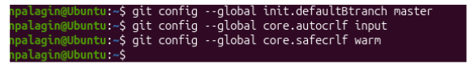{#fig-fig3}

## 2. Создание SSH-ключа

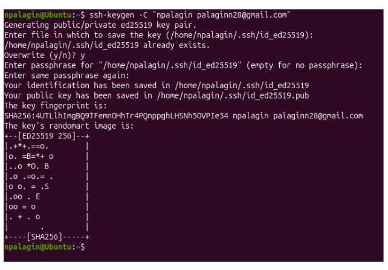{#fig-fig4}

{#fig-fig5}

Заходим в свой аккаунт на сайте githab.

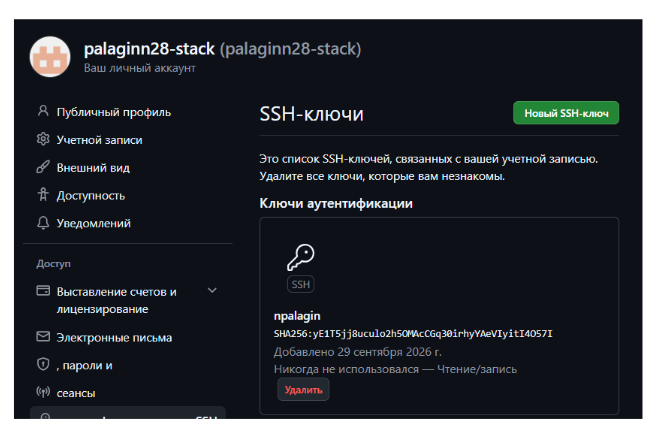{#fig-fig6}

## 3. Создание рабочего пространства и репозитория курса на основе шаблона

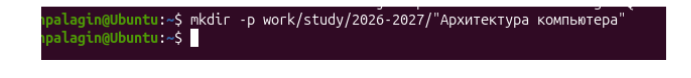{#fig-fig7}

## 4. Создание репозитория курса

Переходим на страницу репозитория с шаблоном.

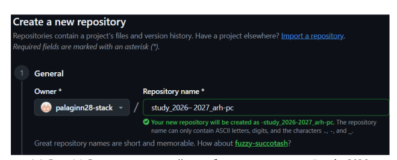{#fig-fig8}

{#fig-fig9}

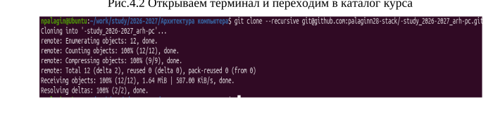{#fig-fig10}

## 5. Настройка каталога курса

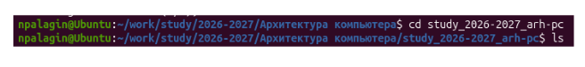{#fig-fig11}

{#fig-fig12}

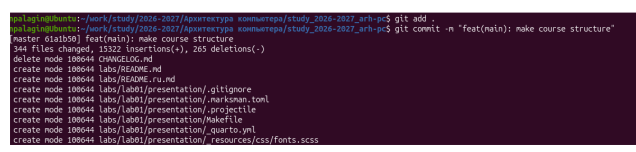{#fig-fig13}

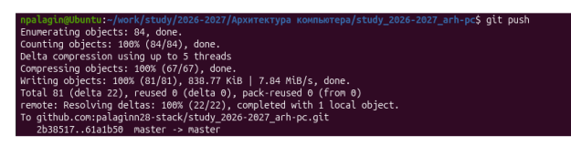{#fig-fig14}

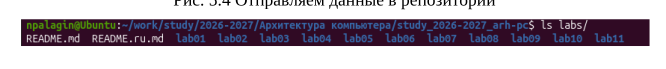{#fig-fig15}

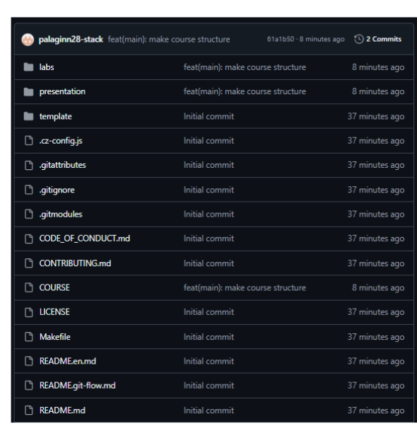{#fig-fig16}

# Задание для самостоятельной работы

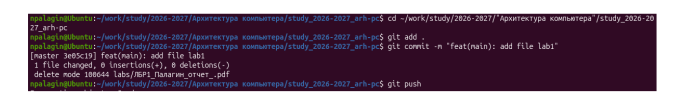{#fig-fig17}

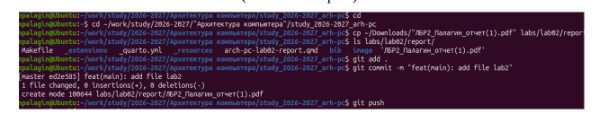{#fig-fig18}

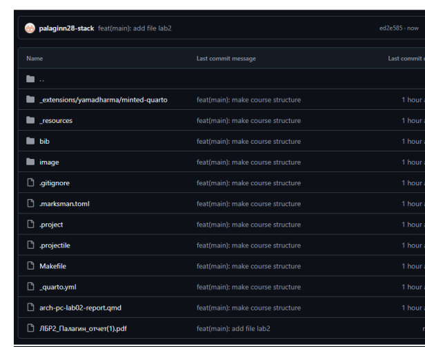{#fig-fig19}

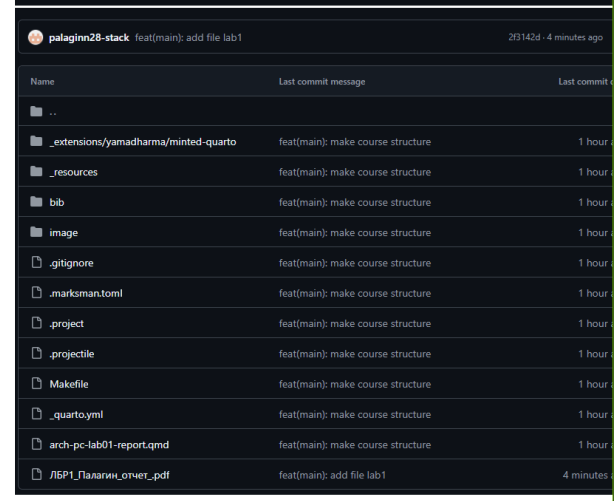{#fig-fig20}

# Выводы

В ходе лабораторной работы мы изучили идеологии и применение средств контроля версий, приобрели практические навыки по работе с системой контроля версий.
