## Цель работы

Целью работы является освоение процедуры оформления отчетов с помощью легковесного языка разметки Markdown.

# Выполнение лабораторной работы

*1. Откройте терминал.*

*2. Перейдите в каталог курса, сформированный при выполнении лабораторной работы № 2:* 
(рис. [-@fig-fig1])

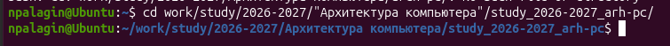{#fig-fig1}

Открыли каталог , который был создан во второй лабораторной работы 

*Обновите локальный репозиторий, скачав изменения из удаленного репозитория с помощью команды*
(рис. [-@fig-fig2])

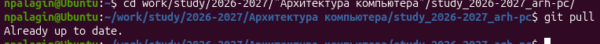{#fig-fig2}

Прописав команду,обновляем локальный репозиторий

*3. Перейдите в каталог с шаблоном отчета по лабораторной работе №3*
(рис. [-@fig-fig3]):

{#fig-fig3}

С помощью команды cd  открываем 3 лабораторную работу

*4. Проведите компиляцию шаблона с использованием Makefile. Для этого введите команду*
(рис. [-@fig-fig4])

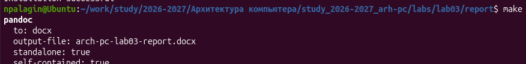{#fig-fig4}

Применяем команду make, чтобы создать шаблон отчета

*При успешной компиляции должны сгенерироваться файлы report.pdf и report.docx. Откройте и проверьте корректность полученных файлов.*
(рис. [-@fig-fig5]),  (рис. [-@fig-fig6])

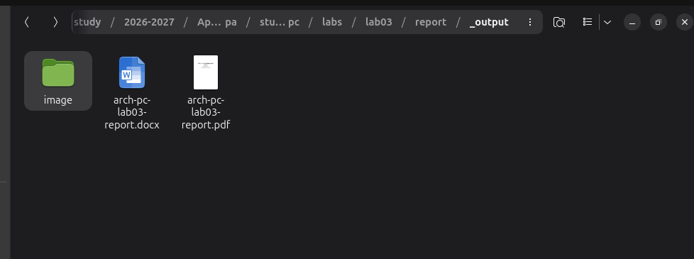{#fig-fig5}

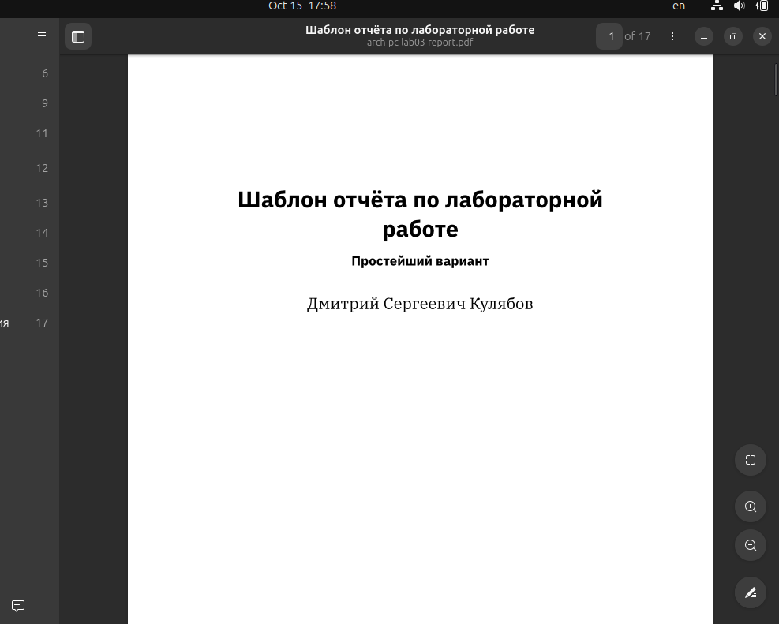{#fig-fig6}

Все файлы корректны

*5. Удалите полученный файлы с использованием Makefile. Для этого введите команду*
(рис. [-@fig-fig7])

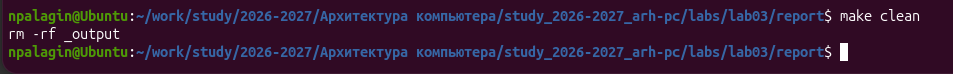{#fig-fig7}

Данной командой make clean мы удаляем шаблоны, созданные с помощью команды make

*Проверьте, что после этой команды файлы report.pdf и report.docx были удалены.*
(рис. [-@fig-fig8])

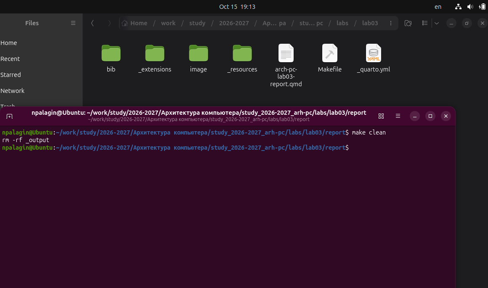{#fig-fig8}

Файлы находились ранее в папке _output, этой папки больше нет, файлы удалены

*6. Откройте файл report.md c помощью любого текстового редактора, например gedit*
(рис. [-@fig-fig9])

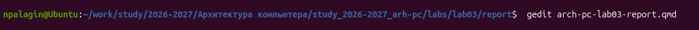{#fig-fig9}

Открываем report.md с помощью gedit

*Внимательно изучите структуру этого файла.*
(рис. [-@fig-fig10])

{#fig-fig10}

Проверяем содержимое файла

*7. Заполните отчет и скомпилируйте отчет с использованием Makefile. Проверьте корректность полученных файлов. (Обратите внимание, для корректного отображения скриншотов они должны быть размещены в каталоге image.)*

Перекидываю изображения в image, заполняю отчет и компилирую файлы

*8. Загрузите файлы на Github*
(рис. [-@fig-fig11])

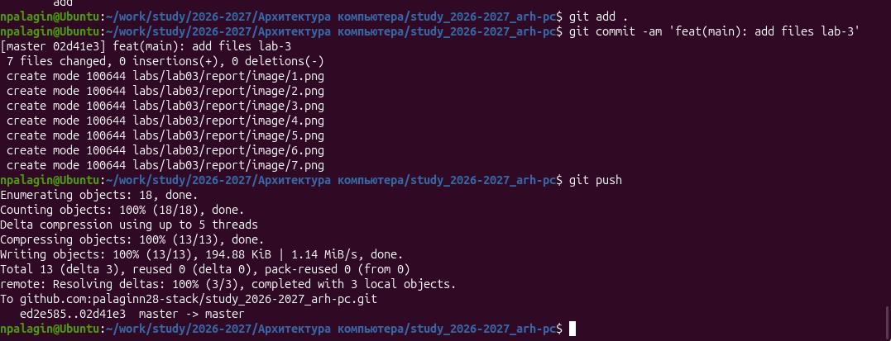{#fig-fig11}

Создал файлы pdf и docx и загрузил на github

# Задание для самостоятельной работы
*В соответствующем каталоге сделайте отчёт по лабораторной работе № 2 в формате Markdown. В качестве отчёта необходимо предоставить отчёты в трех форматах: pdf, docx и md*
(рис. [-@fig-fig12])

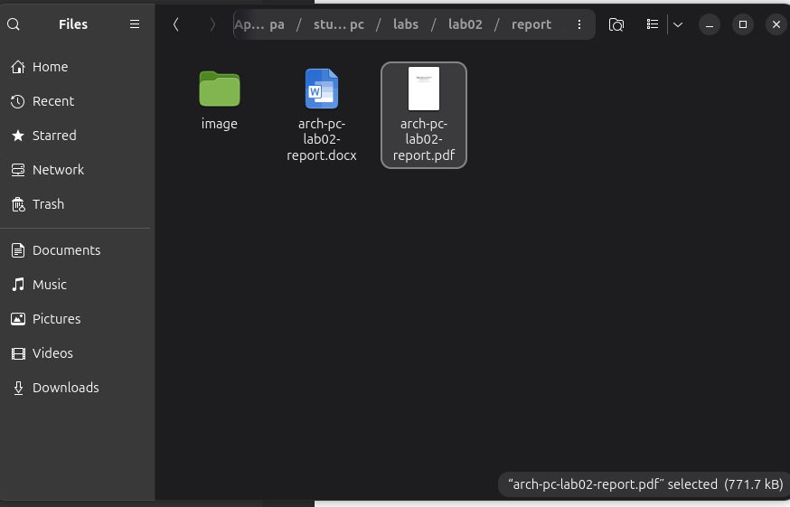{#fig-fig12}

Создал файлы в формате pdf и docx второй лабораторной работы, изменил всё под markdown
(рис. [-@fig-fig13])

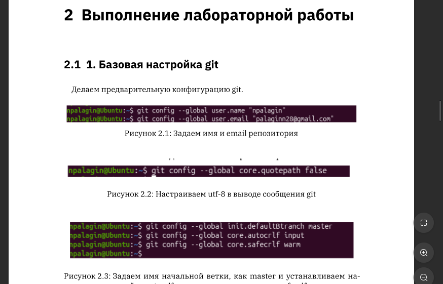{#fig-fig13}

Просматриваем, корректность   файлов

*Загрузите файлы на gitverse*
(рис. [-@fig-fig14])

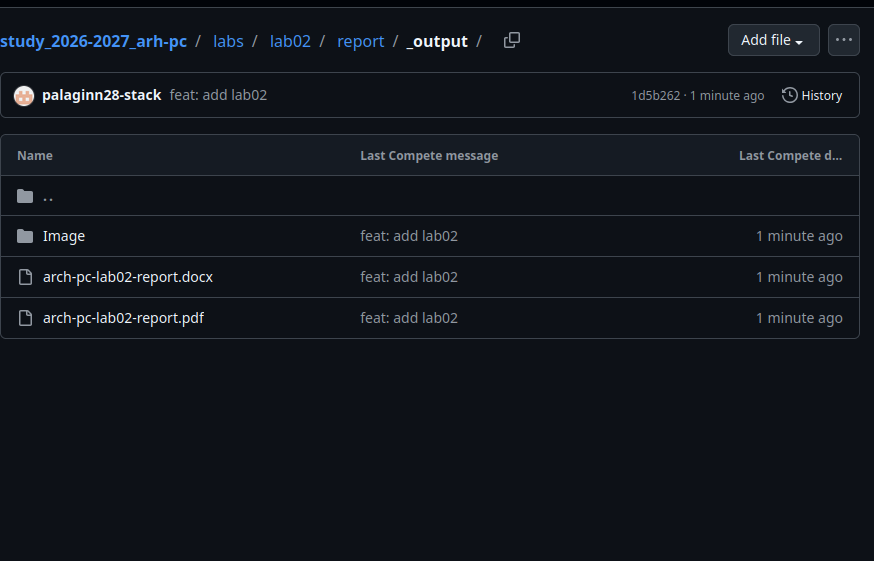{#fig-fig14}

Загрузил файлы на gitverse

# Заключение

В процессе выполнения лабораторной работы я изучил основы языка разметки Markdown и освоил его основные возможности. Также я получил практический опыт оформления текста с помощью различных элементов разметки и закрепил знания, полученные во время предыдущей лабораторной работы.

# Ссылка на репозиторий

https://github.com/palaginn28-stack/study_2026-2027_arh-pc 
